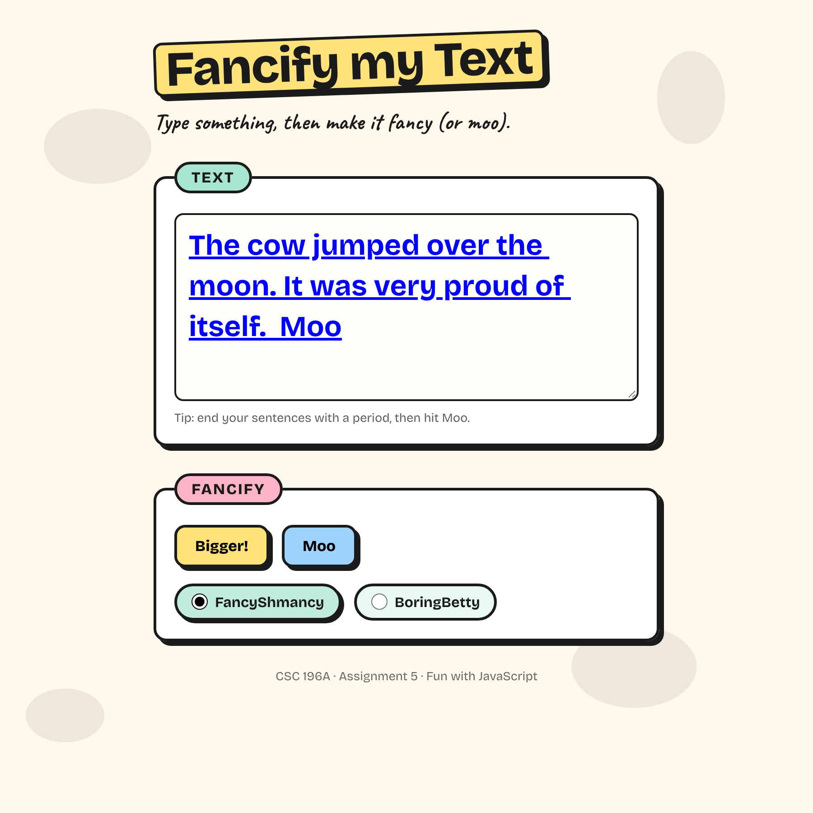

# CSC 196A – Assignment 5: Fun with JavaScript

**Live page:** `https://YOUR-USERNAME.github.io/YOUR-REPO-NAME/fancifymytext.html`

## Files
| File | What it does |
|---|---|
| `fancifymytext.html` | The page: text area, the "Text" and "Fancify" boxes, the buttons and the radio buttons (plus the CSS styling) |
| `fancifymytext.js` | The JavaScript that changes the text |

## What each control does
| Control | Result |
|---|---|
| **Bigger!** | Sets the text size to 24pt |
| **FancyShmancy** | Makes the text bold, blue and underlined |
| **BoringBetty** | Removes those styles |
| **Moo** | UPPERCASES the text and adds `-Moo` to the last word of every sentence |

Example for Moo: `The cow jumped over the moon. It was proud.` → `THE COW JUMPED OVER THE MOON-Moo. IT WAS PROUD-Moo.`

## How I built it (step by step)
1. **HTML controls:** I added a `<textarea rows="4" cols="30">` inside a `<fieldset>` with `<legend>Text</legend>`. A second `<fieldset>` with the legend "Fancify" holds the buttons and the two radio buttons. The radio buttons share `name="style"`, so only one can be picked at a time.
2. **Test alert:** I created `fancifymytext.js` containing `alert("Hello, world!");` and linked it with ``.
3. **Event handler:** I put the alert inside a function and added `onclick="makeBigger()"` to the Bigger! button, so the alert only showed up after a click.
4. **Bigger:** I gave the text area `id="userText"` and changed the function to
   `document.getElementById("userText").style.fontSize = "24pt";`
5. **Radio buttons:** I added `onchange="changeStyle()"` to both radio buttons. The function checks `.checked` and sets `fontWeight`, `color` and `textDecoration`.
6. **Moo:** The function takes `.value`, calls `.toUpperCase()`, uses `split(".")` to break the text into sentences and `split(" ")` to break each sentence into words, adds `-Moo` to the last word, then puts the text back together with `join`.

## Design
The look is a "neo-brutalist sticker" style, a common trend on Pinterest and Dribbble: thick black outlines, offset shadows, pastel colours, pill-shaped labels, and a faint cow-spot background as a nod to the Moo button.
